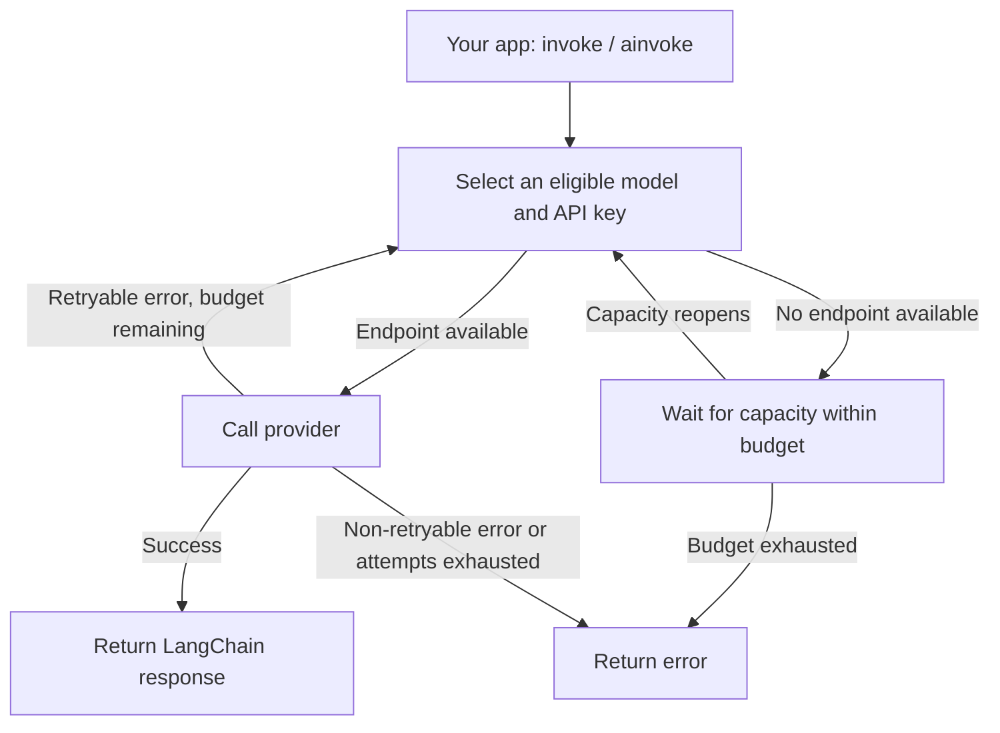

# LLM Pool Manager

### Hit a rate limit? Stop swapping API keys by hand.

Give your app **one LangChain model** backed by multiple models and API keys. The pool picks an available endpoint, tracks configured quotas, and tries another eligible endpoint when a retryable call fails.

**Gemini + OpenAI-compatible APIs · Sync + async · Tools + structured output**

## What happens when you call it?



You choose the model order. The pool handles key selection, cooldowns, and bounded retries. When everything is busy, callers wait fairly within your configured budget—or receive an exhaustion error.

This is the LLM layer for your project. It does not include web scrapers or acquire API keys for you.

## Get running

From the repository root, install into your Python environment:

```shell
python -m pip install -r requirements.txt
```

**1. Put your keys in `.env`.**

```dotenv
GEMINI_API_KEY1=your_first_key
GEMINI_API_KEY2=your_second_key
```

**2. Create `configs/local.yaml`.** Models are tried in preference order; use models enabled for your project.

```yaml
google:
  models: [gemini-3.5-flash-lite, gemini-3.1-flash-lite]
  keys: [GEMINI_API_KEY1, GEMINI_API_KEY2]
```

Check [model_limits.yaml](configs/model_limits.yaml) against your actual RPM, TPM, and daily quotas. The checked-in values are example project settings, not universal free-tier limits.

**3. Use the pool as your chat model.**

```python
from dotenv import load_dotenv
from pool_manager.llm import get_llm

load_dotenv()
llm = get_llm("configs/local.yaml", max_wait_seconds=10, caller_timeout=45)

response = llm.invoke("Explain this error in one sentence: HTTP 429")
print(response.content)
```

Build the pool once and reuse it. In async code, use `await llm.ainvoke(prompt)`.

## Add another provider

Keep Gemini and Groq in the same `configs/local.yaml`:

```yaml
google:
  models: [gemini-3.5-flash-lite, gemini-3.1-flash-lite]
  keys: [GEMINI_API_KEY1, GEMINI_API_KEY2]

groq:
  base_url: https://api.groq.com/openai/v1
  models: [openai/gpt-oss-20b]
  keys: [GROQ_API_KEY]
```

Add `GROQ_API_KEY=your_groq_key` to `.env`. Your Python code stays the same.

With default priority selection, provider blocks and their model lists define preference: Gemini first, then Groq when earlier endpoints are unavailable. Retryable failures prefer eligible endpoints not yet tried.

For Groq and other OpenAI-compatible services, set the provider's `base_url`; omit it for OpenAI's default endpoint. Gemini uses its own client and needs no custom URL. See [Groq's API setup](https://console.groq.com/docs/openai) and choose a [model available to your account](https://console.groq.com/docs/models). Add your actual Groq quotas to `configs/model_limits.yaml` under `groq`; without configured limits, that endpoint relies on reactive rate-limit handling.

## Keep the workflow you already have

| Need | Use |
| --- | --- |
| Tool-calling agents | `llm.bind_tools(tools)` |
| Typed responses | `llm.with_structured_output(schema)` |
| See which endpoints get traffic | `print(llm.usage_report())` |
| More providers or keys | Add provider blocks or key names—[example configuration](configs/llm_config.example.yaml) |
| Bound waiting and retries | Set `max_wait_seconds`, `max_attempts`, and optional `caller_timeout` |

Model order controls preference. During retries, eligible endpoints the call has not tried get priority over revisiting failed ones.

## Know the boundaries

- **More keys do not always mean more quota.** Use independent project quotas where permitted; the pool does not bypass provider limits.
- **Capacity is finite.** If nothing can become available in time, catch `AllEndpointsExhausted` from `pool_manager.scheduler`.
- **Counters live in one pool instance.** They are not persisted or shared across processes. Token accounting uses completed response usage.

## Want to look closer?

**360 offline tests passed**, including sync/async failover and scheduler regressions. Run them with `python -m pytest -q`; no API calls required.

[Evaluation guide](evals/README.md) · [Caller deadline behavior](docs/caller_deadlines.md)