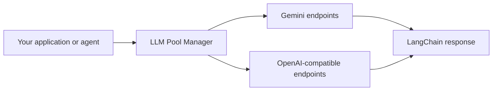

# LLM Pool Manager

**One LangChain chat model. Multiple providers, models, and API keys.**

Route LLM calls across Gemini and OpenAI-compatible endpoints, respect configured quotas, and fail over when a provider becomes unavailable—without putting that routing logic in your application.

[Quick start](#quick-start) · [Configuration](#configuration) · [Results](#tested-beyond-the-happy-path) · [Documentation](#documentation)

## Why use it?

A failed API key or an exhausted model should not strand a request while another endpoint can serve it. LLM Pool Manager brings endpoint selection, quota-aware admission, and retries behind the familiar `invoke` / `ainvoke` interface.

- **Keep your LangChain workflow.** Supports synchronous and asynchronous calls, tool binding, and structured output.
- **Prefer the models you choose.** Use models in configuration order, rotate their keys, then fall back to another model. A balanced strategy is also available.
- **Use available alternatives.** Retryable failures prefer eligible endpoints the request has not tried yet.
- **Share capacity fairly.** Sync and async callers use one FIFO admission queue, with notifications and quota-reopening timers.
- **Control waiting and retries.** Configure admission budgets, attempt limits, provider timeouts, and an optional overall caller deadline.
- **See where traffic goes.** Inspect per-endpoint usage, errors, quota counters, and cooldowns.



## Quick start

From the repository root, create an environment and install dependencies. On Windows PowerShell:

```powershell
python -m venv .venv
.\.venv\Scripts\python.exe -m pip install -r requirements.txt
Copy-Item configs/llm_config.example.yaml configs/local.yaml
```

Create a `.env` file with the key names used by the example configuration:

```dotenv
GEMINI_API_KEY1=your_first_key
GEMINI_API_KEY2=your_second_key
```

Build one pool and reuse it across calls:

```python
from dotenv import load_dotenv
from pool_manager.llm import get_llm

load_dotenv()

llm = get_llm(
    "configs/local.yaml",
    request_timeout=30,
    max_wait_seconds=10,
    max_attempts=4,
    caller_timeout=45,
)

response = llm.invoke("Explain exponential backoff in one sentence.")
print(response.content)
print(llm.usage_report())
```

Use the same object in asynchronous application code:

```python
import asyncio

async def main():
    responses = await asyncio.gather(
        llm.ainvoke("Explain a sliding-window rate limit."),
        llm.ainvoke("Explain FIFO scheduling."),
    )
    for response in responses:
        print(response.content)

asyncio.run(main())
```

`llm.bind_tools(tools)` and `llm.with_structured_output(schema)` also use the pool's failover paths. When capacity cannot become available within the admission budget, catch `AllEndpointsExhausted` from `pool_manager.scheduler`; an overall caller deadline raises `CallerDeadlineExceeded` from `pool_manager.deadline`.

## Configuration

List models in preference order and reference API keys by environment-variable name:

```yaml
google:
  models: [gemini-3.5-flash-lite, gemini-3.1-flash-lite]
  keys: [GEMINI_API_KEY1, GEMINI_API_KEY2]
```

Each provider/model/key combination becomes an endpoint. With priority selection, the pool uses available keys for the preferred model before moving to the next model. Add an OpenAI-compatible provider with its models, key names, and optional `base_url`; see the [example configuration](configs/llm_config.example.yaml).

The [model-limits catalogue](configs/model_limits.yaml) supplies local RPM, TPM, and RPD settings. Adjust these to your actual project quotas before running traffic. Google quotas are shared per project: two keys from the same project do not provide two independent budgets.

## Tested beyond the happy path

| Check | Result |
| --- | --- |
| Retry starvation: all 24 endpoint-priority permutations, sync + async | **48/48 passed**, versus **0/48** on the reproduced pre-fix version |
| FIFO fairness: 1,000 simulated callers | Overtaken callers **328 → 0**; p99 queue wait **58.7s → 46.9s** |
| Wake-up regression: controlled 100-caller burst | Admissions **71 → 96**, using every slot available within the wait budget |
| Wake-up comparison: two 1,000-caller Gemini runs at 48/min | Observed eligible-capacity idle with queued callers **68.9s → 6.6s**, a **90.4% reduction** |
| Separate Gemini soak at 30 requests/minute | **1,000/1,000 responses**, exactly **1,000 attempts**, no provider errors or retries |

These measure different workloads. The FIFO simulation traded a higher median wait for fairness and a lower p99. In the paired live wake-up comparison, admission p95 improved **2.3%**, while provider errors increased **8 → 20** with retries disabled. The separate 30/minute soak predates the wake-up fix. Full methodology, failures, and limitations are retained in the [benchmark notes](docs/benchmarks.md).

## Scope

Quota state and scheduling are local to one pool instance; they are not coordinated across processes or persisted across restarts. Token accounting uses completed response usage rather than reserving all possible output tokens in flight. Local limits cannot guarantee provider availability or eliminate genuine quota waiting.

Live provider results cover Gemini. OpenAI-compatible support is covered by implementation and offline tests. Overall deadlines are optional; synchronous expiry returns control to the caller but cannot forcibly stop a blocking SDK worker. See [deadline semantics](docs/caller_deadlines.md).

## Development

The latest full offline verification passed **360 tests**. Run the suite without API calls:

```powershell
.\.venv\Scripts\python.exe -m pytest -q
```

For load tests, result recording, and explicit live-run commands, see the [evaluation guide](evals/README.md) for CLI commands and PowerShell usage.

## Documentation

- [Benchmark notes](docs/benchmarks.md) — workloads, selected results, and tradeoffs.
- [Evaluation guide](evals/README.md) — offline checks and explicit live-run commands.
- [Caller deadlines](docs/caller_deadlines.md) — timeout behavior and cancellation limits.
