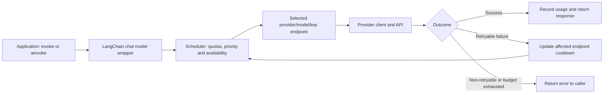

# Pool manager: project overview and final evidence

> Publication checkpoint, 30 October 2026: the publication-curation verification was performed at `0802ff1`. At this local update, HEAD is `de31d82`, with the public documentation changes staged; no commit was created for this update. The unpublished history was curated to exclude raw results and private research documents. This full metrics document and its linked investigation archive remain local and untracked; they are not currently included in GitHub. The archive ignore rules are currently commented out in `.gitignore`, so broad staging commands could include these files. Selective staging is required until that policy is restored or revised. Original commit IDs and dirty-tree source hashes below describe the preserved historical experiments, not necessarily commits reachable in the curated public history. A verified local Git bundle preserves the original history.

## Latest verification: 30 October 2026

| Verification | Result | Scope |
| --- | --- | --- |
| Complete offline suite before publication curation | **360 passed, 0 failed**, 237.01s | Full package, scheduler, failover, deadlines, and evaluation-tool checks; no real API calls |
| Clean public-checkout verification after curation | **70 passed, 0 failed**, 8.30s | Retry-starvation permutations, FIFO wake-up regressions, admission recorder, and comparison analyzer, without the local research archive |
| Package and test source integrity | Unchanged Git blobs | Verified package/test contents match the version that passed the 360-test suite |
| Local archive preservation | **264 files unchanged** | Hash-verified detailed documents, results, and local handoff material |
| Public-history audit | **0 excluded paths** across 19 commits including GitHub's initial commit | Raw results/private docs are absent from the curated branch's reachable history |

## What this project does

`pool_manager` is a Python library that exposes multiple LLM endpoints as one LangChain chat model. An endpoint means a **provider + model + API-key combination**. Applications call one model interface; the library selects an eligible endpoint, accounts for its local quotas and switches endpoints when a retryable failure occurs.

The problem is that an application can have several usable models or independent project keys while one endpoint is temporarily unavailable. Retrying that same endpoint wastes time and quota while other capacity sits idle. Simple round-robin also ignores model preference, minute/daily limits and endpoint health. This project combines quota admission, endpoint selection, failure classification and bounded waiting behind the normal LangChain interface.

The intended use is a single application process issuing synchronous or overlapping asynchronous LLM calls. The code supports Gemini and OpenAI-compatible clients; the live evidence here is Gemini-only. It is a client-side routing library, not a hosted API service or distributed quota coordinator. Models remain responsible for response quality and generation speed.

## How requests flow



Configuration expands in **provider → model → keys** order. For example, two Lite models across two independent project keys create four endpoints. By default the scheduler prefers the first model with headroom, then balances its keys using in-flight count and least-recent use. Within a retrying invocation, eligible endpoints not yet tried take precedence over revisiting one. It may reuse a tried endpoint when no untried endpoint is eligible; the attempt budget does not guarantee visiting an arbitrarily large grid.

Each endpoint reserves request quota before dispatch. Sliding minute slots become reusable as their requests age out; configured Gemini daily counters reset at midnight Pacific. Provider 429s apply rate/daily cooldowns, transient server/transport errors apply endpoint backoff, and invalid credentials or unavailable models quarantine the affected endpoint. Non-retryable request errors are returned rather than consuming healthy endpoints. SDK retries are disabled so retry selection remains under pool control.

Caller waiting and provider attempt time are separate budgets. A 70s scheduler-wait budget is **not** a 70s overall response deadline: provider work and retries add time. Limits, cooldowns and counters are local to the process. TPM accounting uses observed completed usage rather than reserving unknown in-flight token counts.

Admission uses one FIFO queue shared by synchronous and asynchronous callers. This prevents newer callers overtaking older live waiters, independently of endpoint retry order. The evaluated 1,000-call baseline still polled and could leave quota idle during bursts. The subsequent committed fix notifies the next waiter and uses quota-reopening timers; its matched 1,000-call live comparison is complete, with the results above. Optional `caller_timeout` covers admission, provider work and retries and defaults to disabled; it was disabled in both latest soaks. Sync deadline expiry cannot terminate a blocked SDK worker. See the [deadline behavior and limits](caller_deadlines.md).

## Application interface and repository map

```python
from dotenv import load_dotenv
from pool_manager.llm import get_llm

load_dotenv()
llm = get_llm(
    "configs/llm_config.yaml",
    request_timeout=60,
    max_wait_seconds=70,
)
reply = llm.invoke("Reply with one word: ok")
# In an async application: reply = await llm.ainvoke(prompt)
print(llm.stats())
```

The wrapper also supports `bind_tools` and `with_structured_output`. Those paths share failover helpers; the live one-word workloads do not establish their model-specific output quality.

| Location | Responsibility |
| --- | --- |
| [pool_manager/llm.py](../pool_manager/llm.py) | Endpoint construction, LangChain integration, sync/async failover, tool and structured-output wrappers |
| [scheduler.py](../pool_manager/scheduler.py) | Select/reserve eligible endpoints, enforce bounded waiting, expose pool statistics |
| [endpoint_state.py](../pool_manager/endpoint_state.py) | Sliding windows, daily counters, cooldowns and per-endpoint health |
| [limits.py](../pool_manager/limits.py), [errors.py](../pool_manager/errors.py) | YAML model-limit resolution, calendar resets and wrapped-provider error classification |
| [benchmark.py](../pool_manager/benchmark.py) | Usage/benchmark tracking |
| `configs/`, `configs/evals/` | Application settings and isolated experiment settings; key variable names, not credentials |
| `tests/`, `evals/` | Regression tests, simulated providers, live workload runner and timing diagnostics |

The active live setup uses 3.5 Flash-Lite preferred and 3.1 Flash-Lite fallback, each with two keys from owner-confirmed separate Google projects. Four local endpoints at 12 RPM/490 RPD give 48 RPM and 1,960 nominal daily **attempts**, not guaranteed caller responses. Actual 3.1 project quotas remain unverified. Multiple keys in the same project would share provider quota and would not create independent capacity.

## Engineering work and why it matters

This repository consolidates earlier pool implementations, retaining the endpoint scheduler and integrating usage tracking. The work then addressed packaging, retry starvation, quota recovery and credible evaluation:

| Problem encountered | Change or investigation | Evidence and effect |
| --- | --- | --- |
| Package moved out of `app/` | Updated `app.pool_manager` references to standalone `pool_manager` | Source, tests and evaluation imports follow the new layout |
| Slow failures kept returning to primary keys while fallbacks were usable | Track endpoint IDs already tried by each invocation | Controlled regression reaches the healthy fourth endpoint instead of failing after six repeated primary attempts |
| Endpoints needed to recover after RPM/RPD exhaustion | Sliding-window admission, calendar reset accounting and provider cooldown classification | Live minute-reopening probe plus controlled-clock daily/DST tests; daily rollover was not observed live overnight |
| Arrival schedules labeled Poisson were accidentally issued as bursts | Anchor arrivals to the event-loop clock | Corrected overlapping paced workloads; historical mislabeled observations retained as bursts |
| Floating-point window boundaries could admit incorrectly | Positive minimum waits and randomized boundary checks | Controlled boundary coverage; no claim that all prior simulations were rerun after every patch |
| Updated keys could be shadowed by inherited shell values | Evaluation runner loads selected `.env` explicitly and validates distinct key values | Reproducible credential selection without storing keys in results |
| Long one-word responses raised suspicion of pool overhead | Direct REST traces, mock-HTTP wrapper audit and async overlap checks | Demonstrated upstream delays in individual calls and substantial quota waiting under saturation; an isolated dispatch pause remains unexplained |
| Results needed to survive owner-run tests and interruptions | Unique run folders, incremental journals, checkpoints and source/config metadata | Final run has 1,900 valid caller records, individual attempts and endpoint statistics |
| Claude identified overtaking across callers and late dispatch hidden by invocation metrics | Reproduced fairness on Windows; added FIFO, scheduled-arrival timing and hardened optional loop/HTTP diagnostics | Last full offline suite: 336 passed; later profile subset: 22 passed. Latest soak has 1,000 successful caller records; no new full-suite run was performed for this documentation update |
| FIFO preserved order but left burst capacity idle | Live burst plus real-scheduler offline reproduction | Known unresolved polling wake-up defect; owner declined further package edits |
| Background runs stopped before completion | Preserved journals; later direct-Python Task Scheduler launches produced complete artifacts | Process lifecycle cause remains unknown; scheduler exit status alone is insufficient proof of completion |

The primary contribution is observable admission and failure recovery across endpoints. The evidence below shows when it helps and where waiting, outages and quota ceilings still limit results.

## Measured live results

The historical table uses invocation-to-result latency per successful caller, including scheduler waiting and retries. The current-snapshot table below uses scheduled-arrival-to-result as its primary boundary, including dispatch lateness. Successful-call percentiles exclude failed callers. Arrival rates are requests per **minute**, not RPS. Poisson rates are means; fixed spacing is explicitly marked. Each run used different service/quota conditions, so rows are not controlled paired comparisons.

| Workload | Offered/min | Caller successes | p50 | p95 | p99 |
| --- | ---: | ---: | ---: | ---: | ---: |
| Two Lite models, 1,000-call soak, 60s timeout | 30, Poisson | **1,000/1,000** | 1.033s | **7.918s** | 15.675s |
| 3.5 Lite only, 1,000 calls, full 30-RPM combined cap | 30, Poisson | 976/1,000 | 7.833s | 50.075s | 74.355s |
| Two Lite models, fresh 100-call rerun, 30s timeout | 30, Poisson | 100/100 | 15.463s | 42.675s | 64.900s |
| 3.5 Lite only, 100 calls, spare minute capacity | 24, Poisson | 100/100 | 12.319s | 25.252s | 30.641s |
| Flash preferred with Lite fallback, 12-call smoke test | 30, Poisson | 12/12 | 12.065s | 21.906s | 22.130s |
| Two Lite models, 1,900 calls, 48-RPM combined cap | 60, Poisson | 1,180/1,900 | 31.928s | 72.489s | 94.292s |
| Two Lite models, final 1,900 calls, 48-RPM combined cap | **48, fixed spacing** | **1,807/1,900** | **17.218s** | **64.868s** | **101.317s** |
| Instrumented 12-call Lite diagnostic, later FIFO/deadline snapshot | 12, fixed spacing | 12/12 | 2.186s | 3.667s | 3.752s |

Current FIFO/deadline/instrumentation snapshot, **scheduled-arrival successful-call percentiles**:

| Workload | Offered/min | Caller successes | p50 | p95 | p99 |
| --- | ---: | ---: | ---: | ---: | ---: |
| Diagnostic 100, debug enabled, 30s attempt / 90s caller budget | 30, fixed | 100/100 | 1.019s | 3.048s | 7.148s |
| Diagnostic 100, debug enabled, same budgets | Burst within 1s | 64/100 | 11.595s | 72.667s | 74.971s |
| 30 October quota-limited 1,000-call soak, 60s attempts | 30, Poisson | 965/1,000 | 1.050s | 68.091s | 70.384s |
| **30 October latest successful 1,000-call soak**, 60s attempts | **30, Poisson** | **1,000/1,000** | **0.931s** | **2.980s** | **6.787s** |
| Paired queue test: polling FIFO baseline, 20s attempts / one attempt | 48, Poisson | 992/1,000 | 10.526s | 29.327s | 32.860s |
| Paired queue test: notification FIFO fix, same settings | 48, Poisson | 980/1,000 | 10.638s | 28.302s | 33.256s |

The two 30 October runs have identical recorded source hashes, plans and dependencies; caller deadlines and debug diagnostics were disabled. Latest successful endpoint attempts: 3.5 key1/key2 **370/368**, 3.1 key1/key2 **129/133**; all succeeded, with no retries. Runtime was 33m 32s, peak overlapping callers five, cumulative scheduler time 0.187s versus 1,350.165s in providers. Exactly one caller exceeded 30s; maximum legacy successful latency was 37.735s. In contrast, the earlier run parked both 3.5 endpoints after quota-classified 429s, leaving 24 configured RPM against 30 offered/minute. All 35 failures occurred before provider dispatch. Actual quota availability was not independently verified despite owner-confirmed key resets. This contrast supports capacity-loss queueing, not a FIFO-caused speedup.

Earlier completed experiments include the 100-call, 60s-timeout workload (100/100; p95 about 41.3s), the original 30s comparison (100/100; p95 about 48.7s), and a 100-call burst (86/100; p95 about 88.4s). They remain historical observations; the fresh 30s rerun above does not replace their source data. Early runs mislabeled Poisson before the clock fix are treated as bursts, not paced evidence.

## Live admission comparison after the wake-up fix

These are queue-entry-to-reservation measurements for **all 1,000 admissions**, including calls that later failed at the provider. They are not the successful-call response percentiles in the preceding table.

| Admission metric | Polling FIFO | Notification FIFO |
| --- | ---: | ---: |
| p50 / p95 / p99 | 8.316s / 26.874s / 30.327s | 8.130s / 26.260s / 29.835s |
| Admission failures / overtaking | 0 / 0 | 0 / 0 |
| Observed eligible-capacity idle with queue | 68.902s | 6.605s |
| Longest such idle interval | 3.912s | 0.02745s |
| Wait decisions recorded | 12,690 | 2,013 |
| Provider attempts / failures | 1,000 / 8 | 1,000 / 20 |
| Events / dropped records | 22,366 / 0 | 12,353 / 0 |

Both runs used 1,000 seed-1 Poisson arrivals at 48/minute, 12 RPM per endpoint, 20s attempts, a 70s admission allowance, 100s caller budget and one attempt per caller. Calculations ran only after recording closed. The fix cut observed idle-capacity intervals by 90.4%, but admission p95 only 2.3%; genuine full-quota waiting remained. Idle includes decision/recording and OS/event-loop scheduling time, so it is not pure avoidable sleep. Provider conditions worsened in the fixed run; all 20 errors were on 3.1 Lite, versus eight there in the baseline. No provider 429 or daily-cap exhaustion occurred. Overall response completion did not improve.
## Strongest claims and their boundaries

- **Exhaustive retry-starvation regression:** 48/48 current cases passed: all 24 endpoint-priority permutations through sync and async calls, exactly four provider attempts each (503, connection error, 504, success). The byte-identical test failed 48/48 against actual pre-fix commit `3b27c28`, which retried the first endpoint six times. Real pool/scheduler, provider doubles only, zero cooldown configuration; no sleeps or virtual-time duration metrics.
- **Sustained recovery:** the 1,000-call soak completed every caller, used all four endpoints and recovered nine callers after 12 failed attempts: eight HTTP 503s and four connection errors. Total attempts: 1,012; provider 429s: zero. This is a measured 30/minute result, not a claim of 1,000 RPS.
- **Latest sustained healthy-capacity observation:** the 30 October repeat completed 1,000/1,000 with 1,000 attempts, no errors or retries and scheduled-arrival p95 2.980s. It demonstrates successful routing at 30/minute; the earlier recovery soak and regression tests demonstrate failover, because this run had no failures to recover.
- **Visible operating boundary:** the final 48/minute test completed 95.105%, with 93 local exhaustion outcomes and zero provider 429s. All 960 attempts on 3.5 Lite succeeded. All 66 failed attempts occurred on 3.1 Lite: 65 HTTP errors plus one transport error. Forty-six callers recovered on retry. Daily caps were not reached; 73 failed callers never acquired an endpoint. Matching arrival RPM to admission RPM leaves no retry or cooldown allowance.
- **Controlled retry fix:** a regression that previously revisited primary endpoints and failed after six attempts now reaches the healthy fourth endpoint. Time to outcome improved from 60 virtual seconds and failure to 30 virtual seconds and success. This deterministic test supports causality; unrelated live samples do not.
- **Historical simulation:** 4,020 saved runs over 30 seeds. At 90% load, success was 100% versus 98.2% for the best alternative by success; p95 was 7.4s versus 19.7s (about 62% lower). Under faults, success was 97.2% versus 88.4%. Some regimes showed no benefit, and understated quotas made the pool worse. These are simulated comparisons with differing tested default wait budgets.

The 1,900-call capacity runs and the later 1,000-call soaks describe different observed conditions; none invalidates the others. The change from 62.105% completion at 60/minute to 95.105% at 48/minute is descriptive; projects, schedule and provider errors also changed. No matched experiment establishes an optimal 12-RPM or 490-RPD margin. The historical 336-pass full-suite result predates those live runs. The latest full offline verification is 360 passed, as recorded above; these are successive suite snapshots, not counts to add together.

## Latency investigation

Direct REST bypassing the pool, LangChain and SDK completed 11/12 requests; all six concurrent requests succeeded. Across the 11 successful samples, p50/p95/p99 was **3.927s / 17.877s / 22.646s**. A direct Flash request took 23.838s, with 23.819s server-reported duration. These tiny mixed-model samples demonstrate upstream variability, not reliable tail percentiles or a fair speed comparison against a sustained pool workload.

Offline mocked-HTTP p95 was approximately **0.382ms raw HTTP, 1.282ms SDK, 3.122ms LangChain and 3.886ms pool + LangChain**. Async tests demonstrated overlapping transport calls at concurrency 1, 8 and 32. These exclude real network/provider behavior; they do not clear every possible live SDK issue. The isolated 6.785s dispatch pause remains unexplained.

In the 28 October 1,900-call run, scheduler acquisition totaled 39,620.083 caller-seconds versus 9,329.212 provider-attempt seconds. Dispatch lateness p95 was 20.75ms and maximum 213.23ms. This supports admission/cooldown waiting as a major source of that run's latency. The later 30 October quota-limited run accumulated 11,995.172 scheduler seconds; its same-code healthy-capacity repeat accumulated only 0.187s. Provider-attempt time still includes wrapper, network and upstream work; summed times overlap across callers and are not elapsed runtime.

Claude's review prompted three separate investigations: historical upstream slowness, delayed event-loop servicing, and unfair admission. We reproduced unfair admission and implemented FIFO; added optional deadlines without changing defaults; and hardened the diagnostic before use. The original pause's cause remains unknown. Debug diagnostics captured separate startup stalls up to 2.665s, including traceback/linecache work, and add overhead themselves. The latest clean soak had diagnostics disabled, so its zero overlap count is not proof of no stalls.

## Completion status

The requested main coverage is complete: sustained multi-model and single-model tests, 30s/60s timeout observations including the fresh 30s rerun, asynchronous paced arrivals, burst overload, a Flash smoke test, bare sequential/concurrent API calls, offline wrapper/concurrency audits, and the final 1,900-call runs at 60 and 48/minute.

Not every prepared command has a completed measurement:

| Variant | Final status |
| --- | --- |
| 1,400 calls at 36/minute | Interrupted after an early daily-quota 429; no full result. Optional future spare-capacity repeat. |
| Exactly 2,000 calls at 60/minute | Prepared, never executed; superseded by the requested 1,900-call revision. |
| Another fresh 100-call 60s sample | Optional; existing 60s observations were reused as requested. |
| 100/1,000 RPS, distributed workers, long-duration real token loads | Not evaluated; outside the completed scope. |

After 336 full-suite tests passed, the continuation added a 12-call diagnostic, two 100-call diagnostics and two initial 1,000-call soaks. The later wake-up phase passed 358 full-suite tests, an eight-call smoke probe and the completed matched pair of 1,000-call queue-focused tests above. The focused 11-test comparison/recorder check is not an additional full-suite count. Afterward, the full offline suite passed 360 tests, and the curated public checkout passed a focused 70-test subset; neither involved live API calls. Three other soak attempts stopped with partial journals (239, 82 and 506 completed callers); they are not completed measurements. The 100-call burst had only about 54s inter-run separation instead of the intended 65s due to a PowerShell timestamp-parsing failure; do not claim independent fresh minute windows. The diagnostic did not reproduce the historical long pause. The later wake-up fix passed controlled burst coverage and the completed live comparison above. Remaining issues include the historical pause's cause, actual provider quota availability, distributed coordination, headroom selection, externally durable process launch and broader workload validation. No further package edit is authorized without asking the owner.